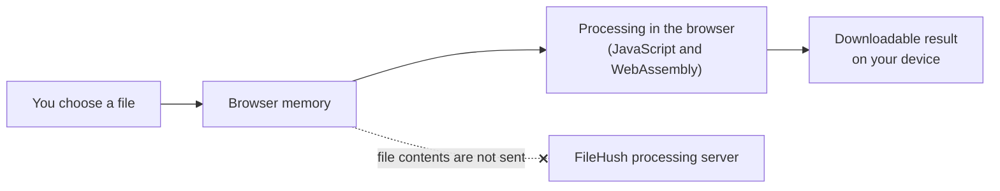

<div align="center">
  
  <h1>FileHush</h1>
  <p><strong>Free file tools. No sign-up. Your files never leave your device.</strong></p>
  <p><a href="https://filehush.org"><strong>Use FileHush at filehush.org →</strong></a></p>

[](https://filehush.org)
[](https://nextjs.org)
[](https://www.typescriptlang.org)
[](#how-privacy-works)
[](#testing-and-quality)

</div>

## Overview

FileHush converts and compresses PDFs and images directly in your web
browser. You pick a file, FileHush processes it on your own device, and you
download the result.

- **No uploads for processing.** Selected files are read and converted
  inside the browser tab; their contents are never sent to a FileHush server.
- **No account.** There is nothing to sign up for or log in to.
- **Free.** Every current tool is free to use.
- **No watermark.** Results are delivered as they are, with nothing stamped
  on them.
- **Analytics that cannot see your files.** The site counts page views, but
  because selected files stay in the browser, analytics has no access to
  their contents.

## Available tools

All ten tools are live on [filehush.org](https://filehush.org).

### PDF to Image

| Tool | What it does |
| --- | --- |
| [PDF to JPG](https://filehush.org/pdf-to-jpg) | Turn every page of a PDF into a JPG image. |
| [PDF to PNG](https://filehush.org/pdf-to-png) | Turn every page of a PDF into a lossless PNG image. |
| [PDF to WebP](https://filehush.org/pdf-to-webp) | Turn every page of a PDF into a compact WebP image. |

### Image to PDF

| Tool | What it does |
| --- | --- |
| [JPG to PDF](https://filehush.org/jpg-to-pdf) | Combine one or more JPG photos into a PDF. |
| [PNG to PDF](https://filehush.org/png-to-pdf) | Combine PNG images into a PDF without losing quality. |
| [WebP to PDF](https://filehush.org/webp-to-pdf) | Turn WebP images into a standard PDF document. |

### Compression

| Tool | What it does |
| --- | --- |
| [Compress JPG](https://filehush.org/compress-jpg) | Shrink JPG photos while choosing the quality to keep. |
| [Compress PNG](https://filehush.org/compress-png) | Optimize PNG files losslessly, transparency intact. |
| [Compress WebP](https://filehush.org/compress-webp) | Reduce WebP file size with your choice of quality. |
| [Compress PDF](https://filehush.org/compress-pdf) | Shrink a PDF while keeping its structure, or flatten it for the smallest file. |

## Why FileHush

- **Processed in your browser.** Conversion and compression run on your
  device, not on a remote machine.
- **No sign-up.** Open a tool and use it straight away.
- **No server-side document handling.** FileHush has no upload API, no
  processing server and no storage for user files.
- **No watermark** on any result.
- **One clear page per tool.** Each tool has its own dedicated page with
  instructions, an FAQ and links to related tools.
- **Works on phones.** File selection, settings and downloads are designed to
  work on small screens as well as desktops.
- **Loads only what you use.** The heavy processing engines are fetched only
  when you start working with a file, so pages stay light.
- **Never larger than the original.** When compression cannot make a file
  smaller, you get your original back, marked as already optimized.
- **Honest PDF compression choices.** Compress PDF explains, before you
  start, what each mode keeps and what it may give up.

## How privacy works



FileHush is still a website, so it uses the network in the normal way: the
pages, scripts and processing components are delivered to your browser when
you visit. The site is hosted on Vercel.

What does not travel over the network is the file you choose. Its contents
are read into browser memory, processed there, and handed back to you as a
local download.

FileHush uses Vercel Web Analytics to count page views in aggregate. It sets
no cookies, and it does not receive file contents or filenames, because
those never leave the browser.

For the full details, read the [Privacy Policy](https://filehush.org/privacy).

## Technical highlights

- **Next.js App Router** with **React** and **strict TypeScript**, styled with
  **Tailwind CSS**.
- **Server Components by default.** Page content, metadata and tool
  explanations are server-rendered; each converter is an interactive Client
  Component island inside its page.
- **PDF.js** renders PDF pages for the PDF-to-image tools and for Maximum PDF
  compression, with its own Web Worker.
- **jsPDF** builds PDFs from images and rebuilds pages for Maximum PDF
  compression.
- **qpdf compiled to WebAssembly** optimises PDFs in a Web Worker for the
  Preserve and Balanced modes.
- **OxiPNG compiled to WebAssembly** performs lossless PNG optimisation.
- **Native browser encoders** (canvas) re-encode JPG and WebP images.
- **Dynamically loaded dependencies.** Processing libraries are imported on
  demand rather than shipped in the initial page bundle.
- **Local downloads** are produced as Blobs and served through Object URLs,
  with multi-file results zipped in the browser.
- **Self-served engines.** Conversion engines and their supporting assets
  (worker scripts, WebAssembly, fonts and colour profiles) are served by the
  application itself, not downloaded from unrelated third-party CDNs during
  processing.
- **Vercel Web Analytics** for cookieless, aggregate page-view counts.
- **Vitest** for unit tests.

The full design, including memory management, lives in
[docs/architecture.md](docs/architecture.md).

## PDF compression modes

[Compress PDF](https://filehush.org/compress-pdf) offers three modes so you
can choose the trade-off yourself:

| Mode | How it works | What it keeps |
| --- | --- | --- |
| **Preserve** | Lossless rewrite with qpdf: streams are recompressed and unused data is dropped. | Everything: text, vectors, links, forms and annotations. |
| **Balanced** | Preserve, plus qpdf's image optimisation, which may recompress embedded images. | Document structure, selectable text, links, forms and vector graphics. |
| **Maximum** | Each page is rendered as an image with PDF.js and placed into a new PDF. | The visual appearance of each page. |

Maximum mode rasterises every page, so it can remove or flatten selectable
text, links, forms, annotations and other interactive content. The tool says
so before you compress.

How much a PDF shrinks depends entirely on its contents. In every mode, if
the result is not smaller than the original, the original is returned
unchanged.

## Getting started locally

### Prerequisites

- Node.js (a current LTS release)
- npm
- A modern browser

### Clone and run

Using SSH:

```bash
git clone git@github.com:SallarBhutto/file-converter-web.git
cd file-converter-web
npm install
npm run dev
```

Using HTTPS:

```bash
git clone https://github.com/SallarBhutto/file-converter-web.git
cd file-converter-web
npm install
npm run dev
```

Then open [http://localhost:3000](http://localhost:3000).

Before the development server starts, a script copies the PDF.js, qpdf and
OxiPNG support files from the installed packages into git-ignored folders
under `public/`, so the app can serve them itself.

## Available commands

| Command | What it does |
| --- | --- |
| `npm run dev` | Prepares the vendor assets, then starts the Next.js development server. |
| `npm run build` | Prepares the vendor assets, then creates a production build. |
| `npm run start` | Serves the production build created by `npm run build`. |
| `npm run lint` | Runs ESLint across the project. |
| `npm run typecheck` | Generates Next.js route types, then type-checks with `tsc --noEmit`. |
| `npm test` | Runs the unit tests once with Vitest. |

## Project structure

```text
src/
├── app/          # routes, page metadata, sitemap and robots
├── components/   # layout, shared tool UI and small primitives
├── features/     # one folder per tool family, with its processing logic
└── lib/          # shared file, PDF, image and SEO utilities
public/
└── brand/        # FileHush logo files
scripts/          # vendor-asset copying and brand icon generation
docs/             # product, architecture and decision documentation
```

## Testing and quality

Every change is expected to pass these four commands:

```bash
npm run lint
npm run typecheck
npm test
npm run build
```

The unit tests run in Node and focus on pure logic that is easy to get
wrong: file validation, size formatting, output filenames, format and quality
preset configuration, progress reporting, render-size limits, page background
planning, image-to-PDF page layout and reordering, EXIF orientation parsing,
compression savings, PDF compression modes and qpdf arguments, and SEO
metadata and routes. Browser-specific processing such as canvas encoding and
PDF rendering is not emulated in unit tests. See
[docs/testing.md](docs/testing.md) for the strategy.

## Documentation

| Document | Covers |
| --- | --- |
| [docs/product.md](docs/product.md) | What FileHush is, who it is for and its privacy principles. |
| [docs/architecture.md](docs/architecture.md) | Browser-only processing, the stack and how each tool works. |
| [docs/seo.md](docs/seo.md) | Routes, metadata, sitemap and content rules. |
| [docs/ui-ux.md](docs/ui-ux.md) | Design direction, tool flow, mobile and accessibility requirements. |
| [docs/coding-standards.md](docs/coding-standards.md) | TypeScript, React and dependency rules. |
| [docs/testing.md](docs/testing.md) | What is tested and why. |
| [docs/roadmap.md](docs/roadmap.md) | What has been built and what may come next. |
| [docs/decisions.md](docs/decisions.md) | The log of architecture and product decisions. |

## Contributing and feedback

Bug reports and focused improvements are welcome through
[GitHub issues](https://github.com/SallarBhutto/file-converter-web/issues)
and pull requests.

To keep FileHush trustworthy, contributions must:

- keep file processing local to the browser;
- never upload the contents of selected files;
- never let analytics receive filenames, file sizes or document contents;
- update the privacy and legal wording whenever data behaviour changes;
- follow the existing project structure and
  [coding standards](docs/coding-standards.md);
- pass `npm run lint`, `npm run typecheck`, `npm test` and `npm run build`.

## License

The source code is publicly viewable, but no license has been granted for
reuse at this time. Please do not assume permission to copy, modify or
redistribute it based on the repository being public. If you would like to
use part of it, open an issue to ask.
